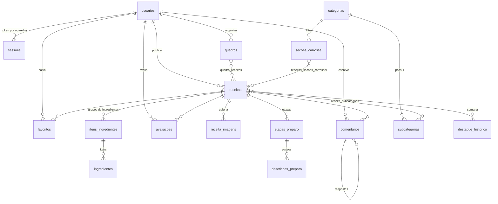

# BraFood — API (Brafood-PHP)

API REST em PHP e MySQL/MariaDB do BraFood, uma aplicação web de receitas. Atende o front-end Angular com cadastro e login, receitas, categorias, favoritos, avaliações, comentários, quadros de receitas salvas, home administrável e painel administrativo.

- **Front-end:** [Brafood-Angular](https://github.com/AnaSouzaPinheiro/Brafood-Angular)
- **Licença:** MIT

## Tecnologias

| Item | Detalhe (fonte) |
| --- | --- |
| Linguagem | PHP 8.2 ou superior (`composer.lock`; testado localmente com 8.2.12) |
| Banco de dados | MySQL/MariaDB via PDO (dump de referência gerado em MariaDB 10.4.32) |
| Gerenciador de dependências | Composer, autoload PSR-4 (`App\Config`, `App\Controller`, `App\Model`, `App\Service`) |
| Bibliotecas | `phpmailer/phpmailer` 7.0, `vlucas/phpdotenv` 5.6 |
| Testes | `phpunit/phpunit` 11.5 (dev) |
| Serviços externos | OpenRouter (geração de receita por IA e sugestão de ícones), Pollinations (imagens das seções), SMTP do Gmail (e-mails) |
| Autenticação | Token de sessão opaco enviado como `Authorization: Bearer` (não é JWT) |

## Funcionalidades

**Autenticação e conta**
- Cadastro com validação de senha e de apelido (identificador público, único), com sugestão automática de apelido.
- Login por e-mail e senha; cada login cria uma sessão própria do aparelho, e sair de um aparelho não derruba os outros.
- Recuperação de senha: gera token com validade de 1 hora e envia o link por e-mail; a redefinição valida o token e a nova senha.
- Perfil: leitura e edição dos dados e da foto; perfil público por apelido.

**Receitas**
- Listagem e busca por texto; listagem por categoria com ordenação (`nome`, `mais_novos`, `mais_antigos`, `mais_favoritos`) e filtros por subcategoria, dificuldade, tipo de porção e tempo máximo.
- Criação, edição e exclusão (somente o dono ou um administrador), com imagem de capa e galeria. As imagens são redimensionadas e recomprimidas no envio; há geração de miniaturas sob demanda (`thumb.php`).
- Ingredientes agrupados e etapas de preparo; a edição aplica apenas as diferenças (`ReceitaDiffService`).
- Geração de receita estruturada a partir de texto livre, via OpenRouter, com fallback entre até 3 modelos.
- Link de compartilhamento de ingredientes pelo WhatsApp.

**Categorias, favoritos, avaliações e comentários**
- Categorias e subcategorias (leitura pública; escrita pelo painel administrativo).
- Favoritos com contador na receita, remoção em massa, status (`quero_fazer`, `ja_fiz`) e nota pessoal.
- Avaliação de 1 a 5 por usuário e receita, com média e total.
- Comentários com respostas aninhadas; um comentário raiz por usuário e receita; edição pelo autor; exclusão pelo autor ou administrador.

**Quadros**
- Quadros de receitas salvas por usuário: criar, editar, reordenar, adicionar e remover receitas, lista de compras a partir das receitas do quadro e compartilhamento público por link (token) ou na página pública do autor.

**Home e painel administrativo**
- Slide da home e seções de carrossel (modo aleatório ou manual, período ativo por data, filtro por categoria/subcategoria), com cache em arquivo de 6 horas.
- Receita em destaque da semana (automática, com histórico, ou fixada manualmente).
- Painel: CRUD de categorias, subcategorias e seções; vínculo de receitas às seções; upload de imagens; geração de imagens das seções por IA.

**Outros**
- Newsletter (inscrição e cancelamento) e formulário de contato por e-mail.
- Logs por dia e por assunto em `logs/`, com retenção automática.

## Endpoints

Todas as rotas ficam em `/routes/<arquivo>.php` (não há roteador central). Corpo em JSON, exceto onde indicado. "Bearer" significa o header `Authorization: Bearer <token>`.

| Método | Rota | Autenticação | Descrição |
| --- | --- | --- | --- |
| POST | `login.php` | Não | Login (`email`, `senha`). Se o corpo trouxer `confirmarSenha`, executa o cadastro |
| POST | `cadastro.php` | Não | Alias do cadastro (`nome`, `apelido`, `email`, `senha`, `confirmarSenha`) |
| POST | `logout.php` | Bearer (opcional) | Encerra a sessão do aparelho atual |
| POST | `solicitar_recuperacao.php` | Não | Envia o e-mail de recuperação (`email`) |
| POST | `resetar_senha.php` | Não | Redefine a senha (`token`, `senha`, `confirmarSenha`) |
| GET | `apelido.php?verificar=` / `?sugerir=` | Não | Valida/disponibilidade de apelido ou sugere um |
| GET | `user.php[?id=]` | Bearer (dono ou admin) | Dados privados do usuário |
| POST | `updateUser.php` | Bearer | Edita o perfil (multipart: `dados` + foto) |
| GET | `perfil_publico.php?apelido=` ou `?id=` | Não | Perfil público |
| GET | `receitas.php?pesquisa=` | Não | Lista/busca receitas |
| GET | `receitas_categoria.php?id=&ordenar=&subcategorias=&dificuldades=&tipos_porcao=&tempo_max=` | Não | Receitas de uma categoria com filtros |
| GET | `receitas/buscar.php?id=` | Não | Detalhe de uma receita |
| POST | `receitas/add.php` | Bearer | Cria receita (multipart: `dados`, `imagem1`, `galeria[]`) |
| POST | `receitas/update.php` | Bearer (dono ou admin) | Edita receita (multipart) |
| DELETE | `receitas/excluir.php?id=` | Bearer (dono ou admin) | Exclui receita |
| GET | `minhas_receitas.php` | Bearer | Receitas do usuário |
| POST | `ai/gerar-receita.php` | Bearer | Gera receita estruturada a partir de `texto` |
| GET | `categorias.php[?id=]` | Não | Categorias |
| GET, POST, PUT, DELETE | `favorito.php` | Bearer | Verificar, listar, adicionar, atualizar status/nota e remover favoritos |
| GET | `avaliacao.php?id_receita=` | Não | Média e total; com `id_usuario`, inclui a nota do usuário |
| POST, DELETE | `avaliacao.php` | Bearer | Salva ou remove a nota do usuário logado |
| GET | `comentarios.php?receita=` | Não | Comentários da receita |
| POST, PUT, DELETE | `comentarios.php` | Bearer | Cria, edita (autor) ou exclui (autor ou admin) |
| GET, POST, PUT, DELETE | `quadros.php` | Bearer | Quadros do usuário, itens, ordem, visibilidade e lista de compras |
| GET | `quadro_publico.php?token=` / `?apelido=` | Não | Quadro público por link ou quadros públicos de um autor |
| GET | `compartilha_ingredientes.php` | Não | Link de WhatsApp com os ingredientes |
| GET | `slide_home.php?limit=` | Não | Slide da home |
| GET | `secoes_carrossel.php` | Não | Seções da home (cache de 6 h) |
| GET | `secoes_carrossel.php?purge` | Bearer + admin | Limpa o cache das seções |
| GET | `receita_destaque.php` | Não | Receita da semana |
| GET (`?busca=`), POST, DELETE | `receita_destaque.php` | Bearer + admin | Buscar candidatas, fixar e remover o destaque manual |
| POST, DELETE | `newsletter.php` | Não | Inscrever e cancelar inscrição |
| POST | `envia_email.php` | Não | Formulário de contato |
| GET | `admin/categorias.php`, `admin/subcategorias.php`, `admin/secoes.php`, `admin/secoes_receitas.php` | Não | Leitura |
| POST, PUT, DELETE | `admin/categorias.php`, `admin/subcategorias.php`, `admin/secoes.php`, `admin/secoes_receitas.php` | Bearer + admin | Escrita |
| POST | `admin/upload_imagem.php?contexto=` | Bearer + admin | Upload (`categorias`, `icone`, `secoes`) |
| POST | `admin/gerar_imagem.php` | Bearer + admin | Sugestão de ícones e geração de imagens por IA |

### Exemplos

Login:

```http
POST /routes/login.php
Content-Type: application/json

{ "email": "usuario@example.com", "senha": "Senha@123" }
```

```json
{
  "success": true,
  "mensagem": "Login realizado com sucesso.",
  "user": {
    "id": 1, "nome": "Nome", "apelido": "nome", "email": "usuario@example.com",
    "genero": null, "bio": "…", "foto_perfil": "…", "is_admin": 0
  },
  "token": "<64 caracteres hexadecimais>"
}
```

Falha de login: HTTP 401 com `{ "success": false, "mensagem": "Email ou senha incorretos" }`.

Avaliar uma receita (o usuário vem do token; o `id_usuario` do corpo é ignorado):

```http
POST /routes/avaliacao.php
Authorization: Bearer <token>
Content-Type: application/json

{ "id_receita": 10, "nota": 5 }
```

Consultar a média:

```http
GET /routes/avaliacao.php?id_receita=10
```

```json
{ "nota": null, "media": 4.5, "total": 2 }
```

Receitas de uma categoria com filtros:

```http
GET /routes/receitas_categoria.php?id=3&ordenar=mais_novos&dificuldades=1,2&tempo_max=60
```

## Autenticação e segurança

- **Token de sessão:** no login, o servidor gera `bin2hex(random_bytes(32))` (64 caracteres) e grava na tabela `sessoes`, um registro por aparelho. O front envia o token em `Authorization: Bearer`. `Auth::usuarioAutenticado()` resolve o usuário a partir da sessão; `Auth::requireAuth()` responde 401 sem sessão válida; `Auth::requireAdmin()` exige também `is_admin = 1` (403 caso contrário); `Auth::requireOwnership()` limita a ação ao dono do recurso ou a um administrador.
- **Senhas:** `password_hash` / `password_verify`. Política: mínimo de 8 caracteres, com dígito, letra minúscula, maiúscula e caractere especial.
- **Recuperação de senha:** token de 40 caracteres hexadecimais com validade de 1 hora, apagado após o uso.
- **Banco:** consultas com prepared statements (PDO).
- **Autoria:** em receitas, comentários e avaliações, o autor sempre vem do token, nunca do corpo da requisição.
- **Upload:** valida o arquivo como imagem (`getimagesize`), redimensiona e recomprime, e grava com nome único. Os arquivos ficam em `uploads/`, fora do versionamento.
- **CORS e acesso a arquivos:** o `.htaccess` restringe as origens permitidas (domínio de produção e `http://localhost:4200`), bloqueia o acesso público a `.env`, `composer.*`, logs, `vendor`, `tests`, `cache` e repassa o header `Authorization` em hospedagens CGI/FastCGI.
- **Erros e logs:** `display_errors` desligado; erros nativos e da aplicação vão para `logs/AAAA-MM-DD/`.

## Arquitetura e estrutura de pastas

Cada arquivo em `routes/` é um endpoint: lê a requisição, chama um Controller, que usa Models (PDO) e Services, e responde em JSON.

```text
BraFood-PHP/
├── .github/workflows/deploy.yml   # Deploy por FTP a cada push na main
├── .htaccess                      # CORS, bloqueio de arquivos sensíveis, reescrita de miniaturas
├── .env.example                   # Modelo das variáveis de ambiente
├── composer.json
├── phpunit.xml
├── index.php                      # Resposta 404 em JSON (não é um roteador)
├── thumb.php                      # Gera e serve miniaturas de receitas
├── config/                        # Auth, Database (PDO singleton), Logger, CORS, leitura do .env
├── routes/                        # Um arquivo por endpoint (admin/, ai/, receitas/ em subpastas)
├── controller/                    # Regras de negócio e validações
├── model/                         # Acesso ao banco
├── service/                       # AiService, UploadService, ApelidoService, ReceitaDiffService,
│                                  # HomeRotacaoService, ImageCleanupService
├── migrations/                    # Alterações de schema (SQL), em ordem de data
├── tests/                         # PHPUnit (bootstrap em tests/bootstrap.php)
├── uploads/                       # Imagens enviadas (não versionado)
├── cache/                         # Cache das seções da home (não versionado)
└── logs/                          # Logs por dia (não versionado)
```

## Banco de dados

O banco é composto por 21 tabelas InnoDB (`utf8mb4`). A pasta `migrations/` guarda apenas as alterações incrementais (a mais antiga é de 2026-11-05).



Tabelas auxiliares: `newsletter_inscritos`. Chaves estrangeiras com `ON DELETE CASCADE` existem em `sessoes`, `receitas`, `receita_imagens`, `ingredientes` (→ `itens_ingredientes`), `etapas_preparo`, `descricoes_preparo`, `comentarios`, `favoritos`, `receita_subcategoria`, `subcategorias` e `receitas_secoes_carrossel`. `secoes_carrossel` usa `ON DELETE SET NULL` para categoria e subcategoria.

## Variáveis de ambiente

A configuração vem somente do arquivo `.env` na raiz (não versionado). Copie `.env.example` e ajuste. Os valores abaixo são fictícios.

```dotenv
APP_ENV=development                  # development | production
APP_URL=http://localhost:4200        # URL do front (usada no link de recuperação de senha)

DB_HOST=localhost                    # Servidor MySQL/MariaDB
DB_NAME=brafood_php                  # Nome do banco
DB_USER=root                         # Usuário do banco
DB_PASSWORD=                         # Senha do banco
DB_PORT=3306                         # Porta

ALLOWED_ORIGIN=http://localhost:4200 # Origem permitida no CORS (o .htaccess também restringe)

MAIL_USER=seuemail@example.com       # Conta SMTP (Gmail) usada nos e-mails
MAIL_PASS=sua_senha_de_app           # Senha de app da conta SMTP

OPENROUTER_API_KEY=sua_chave_aqui    # Geração de receita por IA e sugestão de ícones
# OPENROUTER_MODELS=modelo1,modelo2  # Opcional: até 3 modelos, em ordem de preferência
POLLINATIONS_KEY=sua_chave_aqui      # Geração de imagens das seções no painel admin
```

## Como rodar localmente

Requisitos: PHP 8.2+ (com PDO MySQL, `mbstring` e GD), MySQL/MariaDB, Composer e um servidor web com `mod_rewrite` (por exemplo, XAMPP).

1. Clone o repositório dentro da pasta servida pelo Apache (no XAMPP, `htdocs`):
   ```bash
   git clone https://github.com/AnaSouzaPinheiro/Brafood-PHP.git
   cd Brafood-PHP
   ```
2. Instale as dependências:
   ```bash
   composer install
   ```
3. Crie o banco (`utf8mb4`) e carregue o schema. O repositório só tem as migrations incrementais, sem schema base.
4. Configure o ambiente: `cp .env.example .env` e preencha as variáveis.
5. Garanta permissão de escrita nas pastas `uploads/`, `logs/` e `cache/`.
6. Suba o Apache e o MySQL. A URL base da API usada pelo front em desenvolvimento é a pasta do projeto no servidor local (ver `environment.development.ts` do front).

### Testes

```bash
vendor/bin/phpunit
```

A suíte tem 99 testes e **não usa o banco real**: `tests/bootstrap.php` aponta a conexão para um destino inexistente e os controllers recebem models simulados (mocks).

## Deploy

O workflow `.github/workflows/deploy.yml` roda a cada push na branch `main` (ou manualmente, via `workflow_dispatch`):

1. Verifica se os Secrets obrigatórios existem (FTP e as variáveis de ambiente listadas acima).
2. Roda `composer install --no-dev --optimize-autoloader`.
3. Gera o `.env` de produção a partir dos Secrets (`APP_ENV=production`, `DB_PORT=3306`).
4. Envia os arquivos por FTP para o servidor, excluindo `.github`, `tests`, `uploads`, `logs`, `.env.example`, `phpunit.xml` e `README.md`.

## Minha parte

Projeto pessoal, projetado e desenvolvido integralmente por mim, Ana Letícia de Souza Pinheiro: modelagem, API, interface e deploy.

## Licença

Distribuído sob a licença MIT. Veja o arquivo [LICENSE](https://github.com/AnaSouzaPinheiro/Brafood-PHP/blob/main/LICENSE).

Copyright (c) 2026 Ana Letícia de Souza Pinheiro
